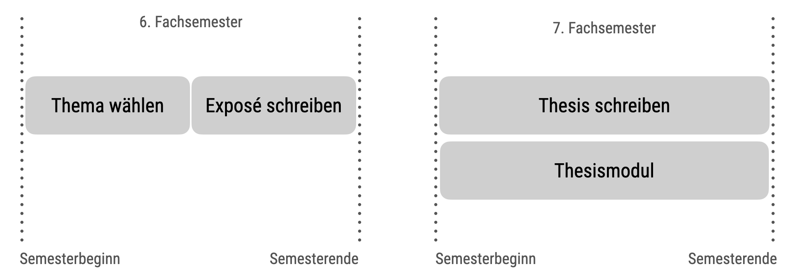

# Besonderheiten von Qualifizierungsarbeiten {#sec-abschlussarbeiten}


Qualifizierungsarbeiten: Bachelorthesis, Masterthesis, Doktorarbeit


:::{.callout-note}
Bitte beachten Sie auch die übrigen Hinweise, insbesondere die Hinweise zu den [schriftlichen Prüfungen](@sec-schriftliche-pruefungen) sowie die [allgemeinen Prüfungshinweise](@sec-allgemeine-pruefungshinweise). 
In @sec-schriftliche-pruefungen finden Sie eine Vielzahl von Hinweisen, 
die auch für Abschlussarbeiten gelten, z.B. zur Seitenanzahl ("Mengengerüst"), 
s. @sec-mengengeruest. $\square$
:::


<!-- ## Hinweise zur Thesis -->


## Willkommen

Liebe Studentin, lieber Student,


Sie überlegen, Ihre Qualifizierungsarbeit (Bachelor-, Master-, Doktorarbeit) bei Professor Sauer zu schreiben. 
Gut! Damit bekommen Sie einen erfahrenen Gutachter und Forscher an Ihre Seite gestellt. 
Wie in jeder Zusammenarbeit gibt es gewisse Erwartungen für einen erfolgreichen Abschluss. 
Es ist in Ihrem Sinne, die Erwartungen Ihres Prüfers gut zu kennen, damit Sie prüfen können, 
ob die skizzierten Rahmenbedingungen für Sie passen. 
Außerdem können Sie Ihre Forschungsarbeit entsprechend ausrichten. 
Je klarer die Erwartungen, desto unwahrscheinlicher ist es, 
dass im Nachgang jemand (z.B. Ihr Prüfer) sagt, 
er habe das ganz anders gewollt.


Bitte bedenken Sie, dass die hier formulierten Erwartungen an Sie nicht zum Komfort Ihres Prüfers erstellt sind. 
Es geht darum, typische Fehler zu vermeiden und einen reibungslosen Ablauf der Begutachtung sicherzustellen. 
Gleichzeitig soll ein solides Qualitätsniveau - 
anspruchsvoll, aber gut machbar - sichergestellt werden. 
Lesen Sie sich bitte die Hinweise sorgfältig durch. 
Wenn Sie sich bei mir für Ihre Abschlussarbeit anmelden, 
gehe ich davon aus, dass Sie diese Hinweise gelesen haben und einverstanden sind.


## Themenwahl

Sie können *selber ein Thema vorschlagen* oder eines der Themen wählen, die ich in meiner Liste freier Themen anbiete (s. @sec-themenliste und @tbl-themen). 
Das Thema soll in Bezug stehen zu Ihrem Studiengang.  
Ich betreue Arbeiten mit verschiedener Methodik: theoretische Arbeiten, Arbeiten mit qualitativer Methodik und Arbeiten mit quantitativer Methodik.
Mein Fokus liegt dabei bei Arbeiten mit quantitativer Methodik.


### Wie finde ich mein Thema?

Wie finde ich mein Thema? Oder wie findet mein Thema mich? Ist das sowas wie Liebe auf den ersten Blick? Wie als würde man in eine Bar gehen und da sitzt dann diese Person am Tresen und man weiß sofort, gleichsam vom Blitz getroffen: Das ist sie/er!

Naja, nicht ganz genau so ist es mit "Ihrem" Thema für Ihre Qualifizierungsarbeit.

Der Weg zum Glück bzw. zu Ihrem Thema heißt: *Lesen*.
Lesen Sie sich in die Fachliteratur ein. 
Also: Recherchieren Sie nach ihrer Idee des Themas, das kann noch sehr grob und ungenau sein.
Diese Idee des Themas kann sich auch noch ändern, das passiert häufig und ist vollkommen in Ordnung. Auf jeden Fall wird sich Ihr Thema noch präzisieren.
Wichtig ist, dass Sie anfangen, sich einzulesen.
Sie lesen also einige Fachliteratur.
Dort finden Sie dann Hinweise für weitere Literatur.
Parallel bauen Sie sich eine Wissenslandkarte zu Ihren Gedanken beim Lesen auf.
So wächst Ihre Idee des Themas, s. @fig-thema.

{#fig-thema width=50%}


:::{.callout-tip}
### Auf den Schultern von Giganten

Tipp: Lesen Sie sich eine Studie genau durch, die ähnlich (in Forschungsfrage oder Methodik) zu Ihrer Themenidee ist.
Dann konzipieren Sie darauf aufbauend eine analoge (ähnliche) Studie. Das ist nicht "Nachmachen 2.0", sondern die Weiterführung bestehender Erkenntnisse.
:::


### Liste meiner freien Themen {#sec-themenliste}

@tbl-themen gibt Ihnen einen Überblick meiner freien Themen.

:::{.callout-tip}
### Bring your own Thema
Wenn Sie klare Vorstellungen von Ihrer Thesis haben, dann schlagen Sie mir ein Thema vor. Voraussetzung ist, dass Sie eine quantitative Methode zur Analyse verwenden. $\square$
:::


<!-- 👉 [Meine Liste freier Themen](https://docs.google.com/spreadsheets/d/1m9KOCF1LzLXnO2eEXZTspYslh8RHfiuWp3oHGySd7OE/edit?usp=sharing) 👈  -->


```{r thesisliste}
#| echo: false
#| cache: false
#| tbl-cap: Liste meiner freien Themen
#| label: tbl-themen

d <- readxl::read_xlsx("Thesisthemen-Prof-Sauer.xlsx")

d <-
  d |> 
  dplyr::filter(Status == "verfügbar")

#d |> DT::datatable(escape = FALSE)

gt::gt(d)
```


### Darf ich ein Thema wählen, das ich schon früher (z.B. in einer Seminararbeit) bearbeitet habe?

Sie dürfen ein Thema in Ihrer Abschlussarbeit bearbeiten, welches *ähnlich* zu einer früheren Prüfungsleistung ist. 
Auf *keinen Fall* dürfen Sie das *gleiche Thema* einer früheren Seminar- oder Abschlussarbeit als Thema Ihrer Thesis verwenden:
Es ist nicht zulässig, eine Arbeit als Prüfungsleistung für mehrere Module (inkl. Thesis) einzureichen.
Im Zweifelsfall sprechen Sie dazu mich oder die Prüfungsabteilung an. 

ABER: Sie dürfen ein Exposé, welches Sie explizit als Vorbereitung für Ihre Abschlussarbeit als Prüfungsleistung eingereicht haben, 
als Grundlage für Ihre Abschlussarbeit verwenden.
Sie dürfen also Teile aus Ihrem Exposé übernehmen.
Diese müssen als (direktes oder indirektes) Zitat gekennzeichnet sein (ansonsten würde es sich um ein Selbstplagiat handeln).

Ich empfehle Ihnen, kaum oder keine direkten Zitate zu übernehmen, 
sondern wenn überhaupt dann nur indirekte Zitate.


## Ablauf bis zur Anmeldung


@fig-anmeldung zeigt den Ablauf der Abschlussarbeit mit einem Fokus auf die Vorbereitung, 
also der Wahl Ihres Themas bzw. die Absprache des Themas mit dem Gutachter (d.h. bis zur Anmeldung).


```{mermaid}
%%| fig-cap: Ablauf der Anmeldung zur Thesis
%%| label: fig-anmeldung
flowchart TD
  A[Studi liest Hinweise]
  B[Studi kontaktiert Betreuer]
  C[Studi schreibt Exposé]
  D[Betreuer gibt Feedback]
  E[Studi meldet formal an]
  F[Los geht's!]
  A-->B-->C-->D-->E-->F
```


1. *Studi liest Hinweise*: Lesen Sie sich als Erstes die Hinweise Ihres Gutachters durch: Welche Themen gibt er oder sie vor? Welche Rahmenbedingungen gibt es?
Wählen Sie ein Thema aus der Liste der verfügbaren Themen für Abschlussarbeiten.
Verschaffen Sie sich einen Überblick über das Thema.

2. *Studi kontaktiert Betreuer*: Sprechen Sie den Gutachter an, dass Sie das Thema bearbeiten wollen. Bringen Sie Ihre Fragen mit zu dem Gespräch? (Das Gespräch kann persönlich sein, via Zoom oder E-Mail stattfinden.)
Wenn Sie sich mit dem Gutachter einig sind über das Thema, sagen Sie explizit verbindlich zu und der Gutachter sagt verbindlich zu.^[Bitte beachten Sie, dass ich Themen erst dann reserviere, wenn Sie verbindlich zugesagt haben. Das hat den Grund, (vielleicht begehrte) Themen nicht unnötig "brach" liegen zu lassen.]

3. *Studi schreibt Exposé*: Jetzt schreiben Sie ein Exposé (und reichen es via Moodle ein).

4. *Betreuer gibt Feedback*: Der Dozent gibt Ihnen schriftlich Feedback zu Ihrem Exposé.

5. *Studi meldet formal an*: Melden Sie zu Beginn des Semesters (in dem Sie Ihre Thesis schreiben wollen) Ihre Arbeit via Primuss an mit dem vom Prüfer bereitgestellten Formular (findet sich in Moodle auf der Seite des Bachelor-Seminars). Mit der Anmeldung wird das Thema der Arbeit fixiert.

6. *Los geht's!*: Puh, jetzt heißt es für drei Monate: Lesen, Denken, Schreiben...
Jippie! Fast geschafft! Sie reichen Ihre Arbeit ein. 
Sie bekommen ein (schriftliches) Gutachten zu Ihrer Arbeit. Ein Kolloquium ist im Rahmen des Bachelorseminars vorgesehen.


:::{.callout-tip}
## Angemeldet ist angemeldet
Wenn Sie angemeldet sind, tickt die Uhr. Außerdem können Sie Ihren Titel nicht mehr (ohne Weiteres) ändern. Daher überlegen Sie sich Ihren Titel gut, bevor Sie die Arbeit anmelden. Der Titel ist ein zentraler Bestandteil Ihrer Arbeit und sollte wohl überlegt sein. $\square$
:::


## Fristen

Bitte beachten Sie, dass es für die Anmeldung und Bearbeitung Ihrer Bachelor- und Masterarbeit definierte Fristen gibt.

1. Wahl des Themas: Die *Wahl des Themas* beginnt mit Beginn des 6. Fachsemesters (SoSe: 15. März, WiSe: 1. Oktober).^[es kann aber auch ein anderes FS sein, z.B. das 7. Fachsemester sein]
2. *Themenvergabe*: Themen (und damit eine verbindliche Zusage meinerseits) vergebe ich bis spätestens Mitte des 6. Fachsemesters (SoSe: 15. Mai, WiSe: 15. November). Nach diesem Termin ist eine Anmeldung (bei mir) erst wieder im Folgesemester möglich (s. Abbildung).
3. *Exposé*: Das Exposé muss bis Semesterende (vor dem Semester Ihrer Abschlussarbeit) bei mir eingereicht sein (SoSe: 30. Juni, WiSe: 31. Dezember).
4. *Feedback zum Exposé*: Sie bekommen gegen Ende des Prüfungszeitraums schriftliches Feedback zu Ihrem Exposé (SoSe: 31. Juli, WiSe: 31. Januar).
5. Die *Bearbeitungszeit* Ihrer Abschlussarbeit *beginnt* mit *Start* des jeweiligen FS (z.B. 7. Fachsemesters; WiSe: 15. Oktober, SoSe: 1. April).
6. Die *Bearbeitungszeit* Ihrer Abschlussarbeit endet *drei Monate* nach Beginn.
7. Ihr *Gutachten* und Ihre Note erhalten Sie i.d.R. bis zu Beginn des Folgesemester.


@fig-zeitplan stellt die Fristen im Überblick dar.

{#fig-zeitplan}


:::callout-important
### Fristen im Blick behalten
Im Anmeldeformular werden o.g. Fristen eingetragen. Damit sind
die Fristen bzw. die Arbeitsdauer festgelegt. Behalten Sie Ihre Fristen gut im Blick. $\square$
:::


## Wie und wann helfen Sie mir bei meiner Bachelor- oder Masterarbeit?

Grundsätzlich sollen Sie in der Abschlussarbeit zeigen, dass Sie befähigt sind, selbständig ein wissenschaftliches Problem zu lösen bzw. eine Problemstellung zu untersuchen, vgl. §28 Absatz 1 der APO. 
Ihre Selbständigkeit ist Teil meiner Erwartung; im Rahmen Ihres Studiums sollten Sie sich alle notwendigen Kompetenzen für die Abschlussarbeit angeeignet haben. Es können aber unerwartete, neue Probleme auftreten (wie eine Datenlage, die ungewöhnliche statistische Verfahren erfordert). 
In diesem Fall stehe ich Ihnen beratend zur Seite. Ansonsten und grundsätzlich sollten Sie selbständig arbeiten.

Da Sie eine wissenschaftliche Aufgabe selbständig lösen sollen, ist ein persönliches Gespräch während der Bearbeitungszeit i.d.R. nicht vorgesehen. 
Bei besonders aufwändigen, ungewöhnlichen oder komplexen Fragestellungen 
- insbesondere wenn Forschungsmethoden verwendet werden, die nicht im Unterricht gelehrt werden - stehe ich auf Wunsch mit einem Beratungsgespräch zur Seite. 
Im Zweifel gilt: Fragen Sie mich einfach; es ist meine Verantwortung, zu entscheiden, 
ob Sie die Frage selber lösen können sollten, oder ob ich Ihnen helfen sollte.

Wichtig ist, dass Sie wissen, dass ich Ihre Arbeit nicht vorab korrigiere - abgesehen von meinem Feedback auf Ihr Exposé. 
Bitte reichen Sie mir nicht Ihre Gliederung, Ihren Fragebogen, Ihren Theorieteil etc. vorab ein. 
Auf der anderen Seite sollten Sie sich aber melden, wenn Sie vor Problemen stehen, die Sie auch nach ernsthaften, ausdauernden Bemühungen nicht lösen können. 

Eine wichtige Hilfe, die ich Ihnen gebe, ist ein Feedback zu Ihrem Exposé (s. unten). Im Rahmen Ihres Exposés skizzieren Sie die zentralen Stränge Ihrer Arbeit vor. 
Auf dieser Basis kann ich Ihnen grobe (!) Anhaltspunkte geben, ob Sie auf dem richtigen Weg sind. 
Bitte beachten Sie, dass ein positives Feedback von mir nicht garantiert, dass Sie die Arbeit mit einer bestimmten (z.B. sehr guten) Note abschließen. 
Ich korrigiere auch nicht alle Fehler im Exposé, sondern zeige Ihnen eine grobe Richtung auf bzw. weise auf einige grobe Fehler hin. 
Ein ausführliches Feedback bekommen Sie erst nach Abgabe – genau darin, in der eigenen Ausarbeitung, besteht Ihre Prüfungsleistung.


## Schreiben Sie ein Exposé

Unterm Strich spart Ihnen das Exposé Zeit bzw. ist ein zentraler Baustein für die Qualität der Arbeit. Fehler können früh erkannt und vermieden werden. 
Die Zeit, die Sie ins Exposé investieren, ist gut investiert. Sie dürfen auch Teile des Exposés identisch in Ihrer Abschlussarbeit verwenden.

Wichtig ist, dass das Exposé Ihnen genau in dem Maße nützt, wie Sie Energie investieren. 
Ein "0815-Exposé" (also ein Exposé ohne Fachkenntnis) wird Ihnen wenig nützen. 
Nur wenn Sie sich auskennen in Ihrem Thema (in Ihrer Forschungsfrage), können Sie ein sinnvolles Exposé schreiben. 
Und nur dann können Sie nützliches Feedback vom Gutachter bekommen. 


### Gliederungsvorschlag zu Ihrem Exposé

Das Exposé ist wie ein normaler wissenschaftlicher Bericht aufzubauen. Folgende Hauptteile sind sinnvoll:

- *Abstract*: Zusammenfassung aller zentralen Punkte des Dokuments (ca. 150 Wörter).

- *Einführung*: Hintergrund und Relevanz Ihrer Forschung sowie die Forschungsfrage und ggf. Hypothesen

- *Theorie*: Zentraler theoretischer Hintergrund zur Forschungsfrage

- *Methoden*: Forschungsdesign, Stichprobe, Messinstrumente, Versuchsablauf, Datenauswertung

- *optional*: Projektplan (Zeit- und Arbeitsplan)


### Einige Tipps zum Exposé

- Beschreiben Sie alle relevanten Aspekte prägnant, aber nur die relevanten Aspekte.

- Die Forschungsfrage sollte prägnant im Exposé vorgestellt sein.

- Falls Sie ein (grobes) Thema zugeteilt bekommen haben, sollten Sie es - ggf. nach Rücksprache - zu einer (konkreten) Forschungsfrage präzisieren.

- Formulieren Sie Hypothesen oder Forschungsfragen konkret, so dass der Leser weiß, was Sie genau machen wollen.

- Stellen Sie den Ablauf des Versuchs vor (was genau eine Versuchsperson macht).

- Diskutieren Sie ggf. ethische Aspekte, die eine Rolle spielen (könnten).

- Geben Sie wenn möglich die Größe der erwarteten Effekte an (z.B. in Pearsons r oder Cohens d) und/oder spezifizieren Sie Ihre Priors (nur bei Bayes-Analysen).

- Planen Sie ggf. die Stichprobengröße passend zum erwarteten Effekt (bei frequentistischer Methodik) bzw. nur Zeitraum und Vorgehen Ihrer Erhebung.

- Zeigen Sie, dass Sie die Literatur überblicken.

- Erläutern Sie ggf. kurz, wie Sie die Stichprobe gewinnen wollen (z.B. Studierende anschreiben).

- Wie in jedem wissenschaftlichen Bericht soll ordentlich zitiert werden. Natürlich bedeutet das auch, dass sich im Literaturverzeichnis genau die zitierte Literatur findet (nicht mehr und nicht weniger).

- Der Umfang des Exposés beträgt ca. 2000 Wörter. Geben Sie die Anzahl der Wörter auf dem Deckblatt an.

- Fügen Sie eine grobe (oder, wenn Sie möchten, bereits genaue) Gliederung Ihrer Arbeit hinzu. Spätere Abweichungen von der Gliederung sind möglich.

- Zitieren Sie ca. mind. 30% der empfohlenen Literaturmenge im Exposé.


## Wenn ich eine theoretische Arbeit schreibe, welche Methode verwende ich dann?

Falls Sie eine theoretische Arbeit schreiben, also keinen empirischen Teil haben, ist Ihre Methode zumeist die des *Literaturstudiums.* 
Eine unsystematische oder systematische Literaturrecherche bietet sich an; die *systematische* ist zu bevorzugen. 
Auch bibliometrische Analysen sind möglich.


## Formalia zur Anmeldung und Abgabe

Wenn Sie ein Formular an mich (oder Dritte, wie die Prüfungsabteilung) senden, 
nennen Sie bitte stets *Ihren Namen im Dateinamen*. 
*Falsch*: "Anmeldung-Thesis.pdf". 
*Richtig*: "Anmeldung-Thesis-Musterfrau-Marina-01234567.pdf".

Bitte *füllen Sie das Formular entsprechend aus*, bevor Sie es mir schicken. 
D.h. tragen Sie Titel der Arbeit sowie Namen der Gutachter schon ein.

Achten Sie darauf, dass ggf. die Papiervariante und die elektronische Variante Ihrer Arbeit *komplett identisch* sind.


## Besonderheiten von Doktorarbeiten

Ich betreue Themen (nur) aus der Psychologie (und angrenzender Wissenschaften), 
denn dort kenne ich die "Spielregeln" und habe einen breiten fachlichen Hintergrund.

Mein Anspruch an Sie ist, dass Ihre Forschungsarbeit *anschlussfähig* ist an den aktuellen wissenschaftlichen Diskurs.
Das zeigt sich vielleicht am objektivsten, wenn Sie in gängigen englischsprachigen Fachzeitschriften publizieren als zentrale Leistung im Rahmen Ihrer Dissertation ("kumulative Promotion").

Falls Sie nicht (oder nur teilweise) über einen psychologischen Fachhintergrund verfügen,
kann es sinnvoll sein, 
vor oder während der Promotion (intensiv) psychologische und wissenschaftsmethodische Fachliteratur zu lesen.

Die kumulative Promotion hat auch den Vorteil, dass Sie von Ihrem Betreuer (z.B. mir) *weniger abhängig* sind: 
Schließlich entscheiden anonyme Fachgutachten über die wissenschaftliche Anschlussfähigkeit Ihrer Forschung.

Mit Blick auf die *Forschungsmethodik* bin ich aufgeschlossen; 
häufig empfiehlt sich eine *Kombination* aus theoretischer Arbeit (Literaturüberblick, wie bibliometrische Analyse oder systematisches Review) 
plus quantitativer Methode (Experimente und/oder Beobachtungsstudien).

Mit meinen Doktorandinnen und Doktoranden pflege ich einerseits regelmäßige Treffen zur Besprechung des aktuellen Stands 
sowie eine Einbindung in Gruppenformate wie z.B. Forschungskolloquien.

Doktorarbeiten sind i.d.R. eingebunden in ein formales Programm der rahmengebenden Hochschule,
was u.a. die Teilnahme an Kursen und Nachweis von Prüfungen und ECTS-Erwerb bedeutet;
ggf. auch Lehre.

Oft dauert eine Doktorarbeit ca. *drei Jahre* bis zur Abgabe, 
wenn man die Doktorarbeit "Teilzeit" bearbeitet.
D.h. wenn man kontinuierlich und ernsthaft der wissenschaftlichen Tätigkeit nachgeht, aber gleichzeitig für den "Broterwerb" arbeitet.

Bedenken Sie, dass es wichtig ist, der Doktorarbeit eine hohe Priorität in Ihrer Zeitplanung einzuräumen, wenn Sie sich für eine Doktorarbeit entschließen. 
Je länger sich das Projekt Doktorarbeit hinzieht, 
desto größer wird die Gefahr, dass es zu keinem Abschluss kommt.

Eine Doktorarbeit ist eine (einmalige) Zeit des Vertiefens in ein Thema.
Das kann große Freude bereiten, aber auch Disziplin und Durchhaltekraft verlangen.
Überlegen Sie sich, inwieweit solche Arbeit zu Ihren Lebensumständen und Präferenzen passen.


## Tipps


- Lesen Sie viel *Fachliteratur.*
- Machen Sie sich *Notizen*, um eine Wissenslandkarte des Gelesenen aufzubauen. Dazu bietet sich ein [Zettelkasten](https://fopro.netlify.app/020-themawahl#zettelkasten) an.
- Auf den *Schultern* von *Giganten*: Orientieren Sie sich in Ihrem Vorgehen an relevanten Fachartikeln und entwickeln Sie diese Ideen weiter.


## Sonstiges

Im Merkblatt für Abschlussarbeiten der Prüfungsabteilung finden Sie weitere formale Vorgaben, etwa zur ehrenwörtlichen Erklärung. 

Hinweise zu einem etwaigen Kolloquium finden Sie im Kapitel @praesentation.

Sie brauchen noch etwas "Rostlöser" zur Auffrischung der (quantitativen) Forschungsmethodik?
Werfen Sie doch mal einen Blick in meinen Kurs ["Forschungsprojekt"](https://fopro.netlify.app/).


